# Урок №1. Знакомство с Python через рисование с Turtle

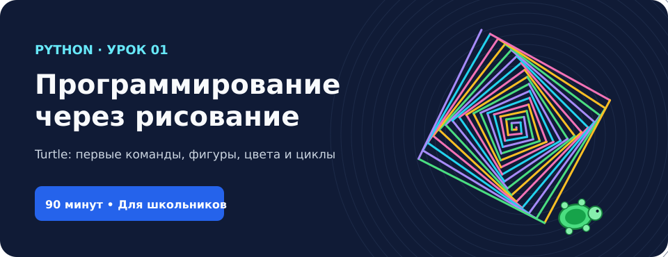

> **Курс:** Программирование на Python для школьников  
> **Продолжительность:** 90 минут  
> **Уровень:** Начальный, предварительных знаний не требуется  
> **Формат:** Короткие объяснения → демонстрация → самостоятельная практика

## Цель занятия

Познакомиться с языком программирования Python и научиться создавать первые графические программы с помощью встроенной библиотеки **Turtle**.

К концу занятия ученик сможет:

- объяснить своими словами, что такое программа и команда;
- самостоятельно запустить Python-файл;
- управлять черепашкой: двигаться вперёд и назад, поворачивать;
- выбирать цвета, толщину линий, поднимать и опускать «карандаш»;
- применять простой цикл `for` для повторения действий;
- создать собственный графический рисунок.

### План занятия

| Время | Этап | Что делаем |
|---|---|---|
| 0–10 мин | Знакомство | Что такое программа, Python и Turtle |
| 10–20 мин | Первая программа | Черепашка рисует линию |
| 20–35 мин | Движения и повороты | Ступеньки, квадрат, прямоугольник, треугольник |
| 35–45 мин | Цвет и перо | Цветные линии, пробелы между линиями |
| 45–60 мин | Цикл `for` | Квадрат, треугольник, шестиугольник |
| 60–70 мин | Красивые рисунки | Звезда, цветок, спираль |
| 70–85 мин | Творческий проект | Домик, солнце или геометрический узор |
| 85–90 мин | Закрепление | Вопросы, мини-викторина, демонстрация работ |

---

# Часть 1. Что такое программирование? (0–10 минут)

## 1.1. Что такое программа?

Компьютер может запускать игры, показывать видео, рассчитывать числа, открывать сайты и рисовать изображения. Но для выполнения действий ему нужны **инструкции**.

**Программа** — это набор команд, которые компьютер выполняет для решения задачи.

Представьте, что вам нужно дать команды игрушечному роботу:

1. Пройди вперёд пять шагов.
2. Поверни направо.
3. Пройди ещё три шага.
4. Остановись.

Вы только что составили простой алгоритм! Если изменить порядок команд, робот окажется в другом месте.

### Обсудим вместе

1. Из каких команд могла бы состоять программа «Приготовь бутерброд»?
2. Почему важно соблюдать порядок инструкций?
3. Что произойдёт, если в инструкции роботу будет ошибка?

## 1.2. Что такое Python?

**Python** — язык программирования. Он позволяет записывать инструкции для компьютера в виде текста. На Python создают программы, сайты, игры, инструменты для работы с данными и многое другое.

Сегодня мы будем не только читать и писать код, но и **видеть результат** каждой команды.

## 1.3. Знакомство с Turtle

*Turtle* по-английски означает «черепаха». В Python есть графическая библиотека `turtle`, позволяющая управлять черепашкой на экране. Она перемещается по заданным командам и может оставлять за собой линии.

Черепашка умеет:

- идти вперёд и назад;
- поворачивать влево и вправо;
- рисовать линии и круги;
- менять цвет и толщину линии;
- перемещаться по координатам без рисования.

**Вопросы перед практикой:** как нарисовать квадрат без мышки? А звезду? Сможет ли программа нарисовать целую картину?

---

# Часть 2. Первая программа (10–20 минут)

## 2.1. Подготовка компьютера

1. Установите [Python](https://www.python.org/downloads/) вместе с редактором **IDLE**.
2. Запустите **IDLE (Python)**.
3. Выберите меню **File → New File**.
4. Сохраните файл под именем `lesson1.py` (**File → Save**).
5. Введите программу и нажмите **F5** (или **Run → Run Module**).

> **Важно:** Turtle использует отдельное графическое окно. Для обычного урока подойдёт Python и IDLE на Windows, macOS или Linux с установленным Tk. В браузерных редакторах и в Google Colab стандартное графическое окно Turtle может не открываться. Для урока удобнее использовать локальный Python.

## Пример 1. Черепашка идёт вперёд

```python
from turtle import *

shape("turtle")
forward(160)

done()
```

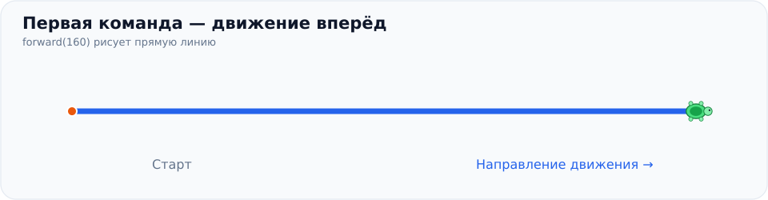

**Разбор программы:**

| Строка | Что означает |
|---|---|
| `from turtle import *` | Подключаем графические команды Turtle |
| `shape("turtle")` | Показываем курсор в виде черепашки |
| `forward(160)` | Двигаем черепашку вперёд на 160 условных единиц |
| `done()` | Оставляем графическое окно открытым |

**Важно:** команды Python часто имеют круглые скобки `()`. Значение внутри скобок называется **аргументом**. Например, `160` задаёт расстояние.

### Задание №1. Первый маршрут

Напишите программу, в которой черепашка:

1. Идёт вперёд на 50 шагов.
2. Идёт вперёд ещё на 100 шагов.
3. Возвращается назад на 80 шагов.

Полезные команды:

```python
forward(50)
backward(80)
```

**Вопрос для размышления:** будет ли черепашка стирать линию, двигаясь назад, или проведёт по ней ещё раз? Проверьте экспериментом.

**Дополнительный вызов:** пройдите 200 шагов вперёд, затем вернитесь в начальную точку одной командой.

---

# Часть 3. Движения и повороты (20–35 минут)

До сих пор черепашка ходила по прямой. Теперь научим её изменять направление.

## 3.1. Основные команды

| Команда | Действие |
|---|---|
| `forward(100)` | Вперёд на 100 шагов |
| `backward(100)` | Назад на 100 шагов |
| `right(90)` | Поворот направо на 90° |
| `left(90)` | Поворот налево на 90° |
| `home()` | Вернуться в центр и смотреть вправо |
| `clear()` | Стереть линии, не сбрасывая положение черепашки |

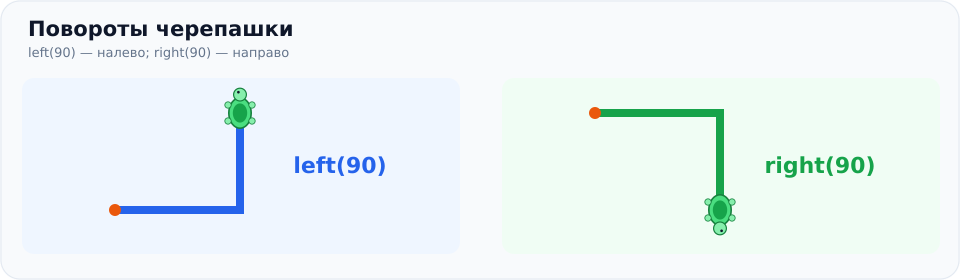

Запомните: **команды `right()` и `left()` только поворачивают черепашку. Сами по себе они не рисуют линию.**

## Пример 2. Рисуем угол

```python
from turtle import *

shape("turtle")

forward(100)
left(90)
forward(100)

done()
```

Черепашка сначала идёт вправо, затем поворачивает вверх и продолжает движение.

### Задание №2. Лестница

Нарисуйте лестницу из двух ступенек.

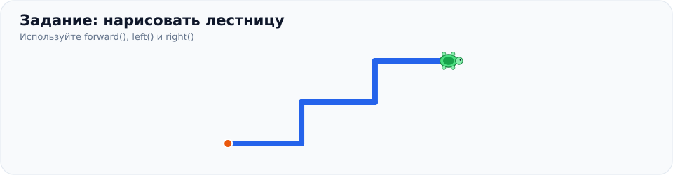

**Условия:**

- Используйте `forward()`, `left()` и `right()`.
- Горизонтальные отрезки имеют одинаковую длину.
- Вертикальные отрезки имеют одинаковую высоту.
- Начните рисовать слева направо.

**Подсказка:** после подъёма вверх необходимо снова повернуть черепашку вправо.

## Пример 3. Рисуем квадрат

У квадрата четыре равные стороны и четыре угла по 90°.

```python
from turtle import *

shape("turtle")

forward(100)
right(90)
forward(100)
right(90)
forward(100)
right(90)
forward(100)
right(90)

done()
```

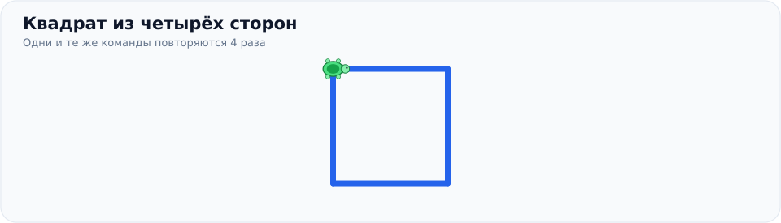

Обратите внимание, что две команды постоянно повторяются. Скоро мы научимся записывать такие программы короче.

### Задание №3. Геометрические фигуры

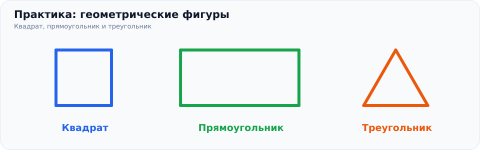

Нарисуйте по очереди:

1. **Квадрат** со стороной 150.
2. **Прямоугольник** со сторонами 200 и 100.
3. **Равносторонний треугольник** со стороной 120.

Используйте команды движения и поворота. Пока можно просто повторять команды без цикла.

**Подсказка к треугольнику:** поворачивать черепашку нужно на 120°, а не на 60°. Она поворачивается на внешний угол фигуры.

**Дополнительно:** нарисуйте букву «П», используя всего несколько команд движения и поворота.

---

# Часть 4. Цвета, толщина линий и «карандаш» (35–45 минут)

Давайте сделаем рисунки более интересными!

## 4.1. Команды оформления

| Команда | Результат |
|---|---|
| `color("red")` | Красный цвет линии |
| `color("blue")` | Синий цвет линии |
| `color("green")` | Зелёный цвет линии |
| `pensize(5)` | Толщина линии — 5 |
| `bgcolor("black")` | Чёрный фон |
| `speed(1)` | Медленное рисование |
| `speed(0)` | Самое быстрое рисование |
| `penup()` | Поднимаем карандаш — следа нет |
| `pendown()` | Опускаем карандаш — снова рисуем |

Названия цветов пишутся на английском в кавычках: `"red"`, `"green"`, `"yellow"`, `"blue"`, `"purple"`, `"orange"`, `"cyan"`.

## Пример 4. Разноцветные линии

```python
from turtle import *

shape("turtle")
pensize(5)

color("red")
forward(100)

left(90)
color("blue")
forward(100)

right(90)
color("green")
forward(100)

done()
```

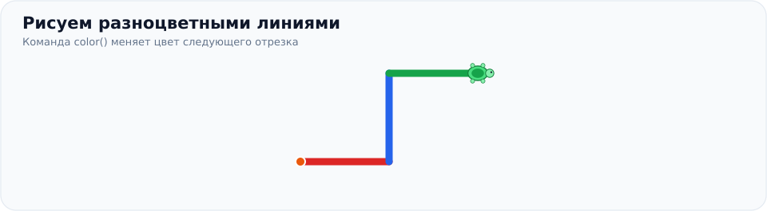

## Пример 5. Линия с пропуском

Чтобы переместить черепашку, не рисуя линию, поднимите «карандаш».

```python
from turtle import *

pensize(5)

forward(50)
penup()
forward(30)
pendown()
forward(50)

done()
```

Получится прямая линия с пустым промежутком посередине.

### Задание №4. Радужная дорожка

Создайте рисунок из трёх отрезков:

1. Красный отрезок длиной 100.
2. Синий отрезок длиной 150.
3. Зелёный отрезок длиной 200.

**Требования:** между отрезками должен быть небольшой пропуск; толщина всех линий — 5.

**Дополнительно:** нарисуйте цветную ломаную линию из пяти отрезков, использовав минимум три цвета.

---

# Часть 5. Цикл `for`: команды без повторного переписывания (45–60 минут)

Посмотрите на квадрат из примера 3. Мы четырежды писали одно и то же:

```python
forward(100)
right(90)
```

Если бы нужно было выполнить одно действие сто раз, переписывать одни и те же команды было бы неудобно.

**Цикл** позволяет повторять команды автоматически.

## 5.1. Как устроен цикл `for`

```python
for i in range(4):
    forward(100)
    right(90)
```

- `for` — начало цикла.
- `i` — переменная, которая меняется во время повторений.
- `range(4)` — цикл выполнится **четыре раза**.
- `:` — двоеточие обозначает начало блока.
- Четыре пробела перед двумя командами — **отступ**. Он показывает, какие команды повторяются.

> В Python отступы имеют значение. Если убрать их перед `forward()` и `right()`, программа не будет работать так, как задумано.

## Пример 6. Квадрат через цикл

```python
from turtle import *

shape("turtle")

for i in range(4):
    forward(100)
    right(90)

done()
```

Получится тот же квадрат, что и раньше, только код станет гораздо короче.

### Разбираем повторения

| Повторение | Что делает черепашка |
|---|---|
| 1 | Идёт 100 шагов и поворачивает направо |
| 2 | Идёт 100 шагов и снова поворачивает |
| 3 | Идёт 100 шагов и снова поворачивает |
| 4 | Рисует последнюю сторону и возвращается к исходному направлению |

**Попробуйте самостоятельно:** замените `range(4)` на `range(3)`. Что будет нарисовано и почему?

## Пример 7. Треугольник через цикл

```python
from turtle import *

color("red")
pensize(4)

for i in range(3):
    forward(120)
    left(120)

done()
```

Почему повторений три? Потому что у треугольника три стороны.

## Пример 8. Шестиугольник

```python
from turtle import *

color("blue")
pensize(3)

for i in range(6):
    forward(80)
    right(60)

done()
```

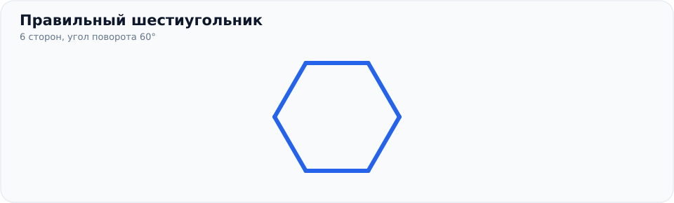

### Как найти угол поворота?

Если фигура **правильная** (все стороны и углы равны), можно воспользоваться правилом:

**Угол поворота = 360° / количество сторон.**

Например, для шестиугольника: `360 / 6 = 60°`.

### Задание №5. Геометрический художник

Нарисуйте с помощью цикла `for` все фигуры из таблицы.

| № | Фигура | Количество сторон | Угол поворота |
|---|---|---:|---:|
| 1 | Квадрат | 4 | 90° |
| 2 | Треугольник | 3 | 120° |
| 3 | Шестиугольник | 6 | 60° |
| 4 | Восьмиугольник | 8 | 45° |
| 5 | Десятиугольник | 10 | 36° |

**Условия:**

- Используйте `for`, а не копируйте команды вручную.
- Задайте цвет и толщину линий.
- Для каждой фигуры выберите подходящую длину стороны, чтобы она помещалась в окно.

**Задание повышенной сложности:** нарисуйте правильный пятиугольник, самостоятельно рассчитав угол поворота.

---

# Часть 6. Рисуем красивые фигуры (60–70 минут)

Мы уже знаем движения, повороты, цвета и циклы. Попробуем объединить эти команды.

## Пример 9. Пятиконечная звезда

```python
from turtle import *

bgcolor("black")
color("yellow")
pensize(3)

for i in range(5):
    forward(180)
    right(144)

done()
```

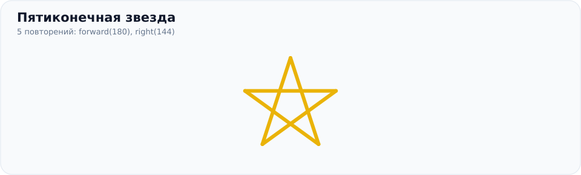

Звезда рисуется пятью отрезками. После каждого отрезка черепашка поворачивается на 144°.

**Мини-задание:** сделайте звезду красной и уменьшите длину её лучей, изменив число `180`.

## Пример 10. Окружность

В Turtle есть команда для рисования круга (точнее, окружности):

```python
from turtle import *

color("red")
pensize(4)

circle(80)

done()
```

Число `80` задаёт радиус окружности.

**Мини-задание:** нарисуйте два круга разного размера и цвета.

## Пример 11. Геометрический цветок

```python
from turtle import *

speed(0)
color("purple")
pensize(2)

for i in range(18):
    circle(80)
    right(20)

done()
```

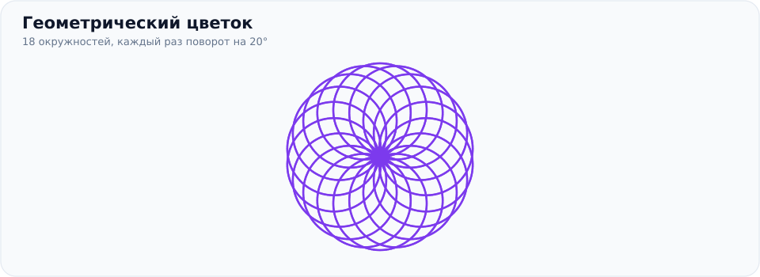

Программа восемнадцать раз рисует окружность, а затем поворачивается на 20°. Так получается красивый цветочный узор.

**Мини-задание:** попробуйте `range(12)` и поворот на 30°. Чем рисунок отличается?

## Пример 12. Разноцветная спираль

Этот пример чуть сложнее. Его можно использовать как **демонстрацию** или дать ученикам, которые быстро справляются с основными заданиями.

```python
from turtle import *

speed(0)
bgcolor("black")

colors = ["red", "yellow", "green", "cyan", "blue"]

for i in range(100):
    color(colors[i % 5])
    forward(i * 3)
    right(91)

done()
```

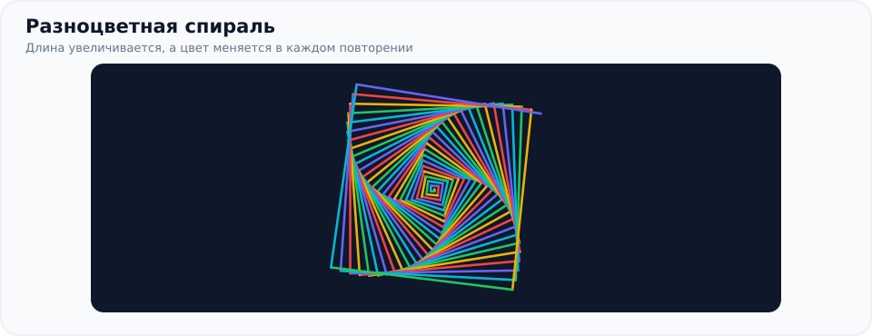

В программе встретились новые выражения:

| Выражение | Назначение |
|---|---|
| `colors = [...]` | Список с пятью цветами |
| `i` | Номер текущего повторения, начиная с 0 |
| `i * 3` | Длина линии становится больше |
| `i % 5` | Остаток от деления помогает повторять номера цветов от 0 до 4 |
| `colors[i % 5]` | Выбирает очередной цвет из списка |

**Необязательно разбирать все новые конструкции сегодня.** Мы подробно изучим переменные, списки и операции на следующих уроках.

### Задание №6. Эксперимент с рисунками

Выберите пример со звездой, цветком или спиралью и измените **минимум три параметра**:

1. Цвет.
2. Размер.
3. Количество повторений.
4. Угол поворота.
5. Толщину линии или цвет фона.

**Цель:** создать рисунок, отличающийся от образца.

---

# Часть 7. Самостоятельный проект «Мой первый рисунок» (70–85 минут)

Выберите **один** из трёх проектов. Работайте самостоятельно или в паре. Можно обращаться к шпаргалке в конце урока.

## Проект №1. Домик (лёгкий)

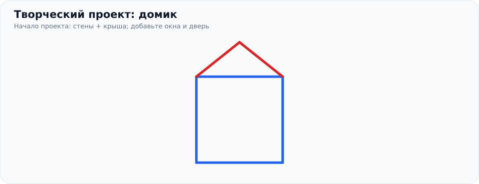

Нужно нарисовать дом с крышей, дверью и двумя окнами. Для перемещения в разные точки пригодятся команды:

- `penup()` — поднять карандаш;
- `pendown()` — опустить карандаш;
- `goto(x, y)` — переместиться в точку с координатами `x` и `y`.

В графическом окне Turtle **центр имеет координаты `(0, 0)`**. Вправо значения `x` увеличиваются, вверх увеличиваются значения `y`.

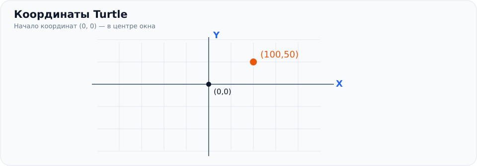

### Стартовый код

```python
from turtle import *

speed(5)
pensize(3)

# Стены дома
color("blue")
penup()
goto(-100, -100)
pendown()

for i in range(4):
    forward(200)
    left(90)

# Крыша дома
color("red")
penup()
goto(-100, 100)
pendown()

goto(0, 180)
goto(100, 100)

done()
```

### Что нужно сделать

1. Запустить стартовый код: на экране должны быть стены и крыша.
2. Нарисовать прямоугольную дверь.
3. Нарисовать два окна.
4. Выбрать свои цвета дома и крыши.
5. **По желанию:** добавить дерево, солнце или дорожку.

**Подсказка:** перед началом новой фигуры можно использовать `penup()` и `goto(x, y)`, чтобы переместиться в нужную точку без лишней линии.

## Проект №2. Солнце (средний)

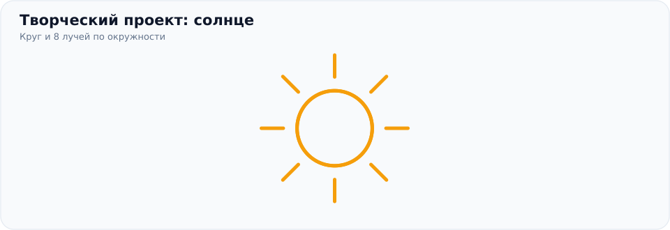

Нужно нарисовать окружность и лучи, направленные в разные стороны.

### Стартовый код

```python
from turtle import *

speed(5)
color("orange")
pensize(3)

# Круг
circle(60)

# Перейти в центр круга
penup()
goto(0, 60)
pendown()

# Допишите лучи здесь

done()
```

После `circle(60)` центр окружности находится в точке `(0, 60)`.

### Что нужно сделать

1. Нарисовать окружность.
2. Добавить **минимум восемь** лучей.
3. Использовать цикл `for`.
4. Выбрать цвета и толщину линий.
5. **По желанию:** нарисовать облака или ещё одно солнце.

**Подсказка для лучей:** стоя в центре солнца, поднимите перо, пройдите 80 шагов, опустите перо, нарисуйте луч длиной 35, снова поднимите перо, вернитесь на 115 шагов назад и повернитесь на 45°. Повторите это 8 раз. Не забудьте `pendown()` перед рисованием и `penup()` перед возвращением в центр.

## Проект №3. Волшебный узор (повышенная сложность)

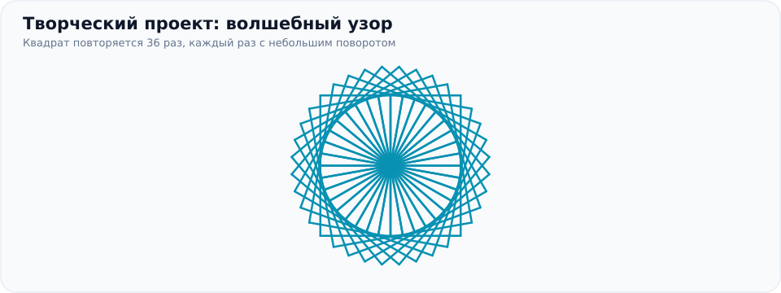

### Стартовый код

```python
from turtle import *

speed(0)
bgcolor("black")
color("cyan")

for i in range(36):
    for j in range(4):
        forward(100)
        right(90)

    right(10)

done()
```

Здесь используется **цикл внутри другого цикла**:

- Внутренний цикл четыре раза рисует стороны квадрата.
- Внешний цикл повторяет квадрат 36 раз, каждый раз немного поворачивая его.

Необязательно подробно изучать вложенные циклы в первый день. Важно понять, что одни и те же действия можно повторять внутри других повторений.

### Что нужно сделать

1. Изменить размер квадратов.
2. Изменить цвет фона и линий.
3. Поменять количество повторений и угол поворота.
4. Сравнить результат до и после изменений.
5. Создать собственный необычный узор.

**Важно:** если вы измените количество повторений, подберите подходящий угол поворота. Для полного оборота сумма поворотов должна составить 360° (например, 24 раза по 15°).

---

# Часть 8. Закрепление (85–90 минут)

## Мини-викторина

Отметьте правильный вариант ответа.

**1. Какая команда двигает черепашку вперёд?**

- [ ] А. `right(100)`
- [ ] Б. `forward(100)`
- [ ] В. `color(100)`

**2. Что делает `right(90)`?**

- [ ] А. Поворачивает направо на 90°
- [ ] Б. Рисует линию длиной 90
- [ ] В. Удаляет рисунок

**3. Какая команда меняет цвет линии?**

- [ ] А. `forward("red")`
- [ ] Б. `shape("red")`
- [ ] В. `color("red")`

**4. Сколько раз выполняется `for i in range(5)`?**

- [ ] А. 4 раза
- [ ] Б. 5 раз
- [ ] В. 6 раз

**5. Какая команда позволяет перемещаться без рисования?**

- [ ] А. `penup()`
- [ ] Б. `pendown()`
- [ ] В. `circle()`

**6. Как записываются команды внутри цикла `for`?**

- [ ] А. Без отступов
- [ ] Б. С отступом под строкой `for`
- [ ] В. Обязательно на одной строке с `for`

<details>
<summary><strong>Ответы для преподавателя (нажмите, чтобы раскрыть)</strong></summary>

1. Б — `forward(100)`.
2. А — поворот вправо на 90°.
3. В — `color("red")`.
4. Б — 5 повторений.
5. А — `penup()`.
6. Б — команды цикла пишутся с отступом.

</details>

## Дополнительные задания

Если вы закончили раньше остальных, выберите одно из заданий:

**Задание А. Разноцветный квадрат.** Каждая сторона квадрата должна иметь свой цвет.

**Задание Б. Олимпийские кольца.** Нарисуйте пять окружностей, которые частично пересекаются. Используйте `circle()`, `penup()` и `goto()`.

**Задание В. Секретная фигура.** До запуска программы попробуйте угадать, какой рисунок получится:

```python
from turtle import *

for i in range(12):
    forward(100)
    right(150)

done()
```

**Задание Г. Свободное творчество.** Придумайте рисунок из фигур, которые мы изучили. Назовите свою программу и объясните соседу, как она работает.

---

# Шпаргалка ученика

| Команда | Назначение |
|---|---|
| `from turtle import *` | Подключить команды Turtle |
| `shape("turtle")` | Показать черепашку |
| `forward(100)` | Двигаться вперёд |
| `backward(100)` | Двигаться назад |
| `left(90)` | Повернуть налево |
| `right(90)` | Повернуть направо |
| `color("red")` | Выбрать красный цвет |
| `pensize(3)` | Установить толщину линии |
| `bgcolor("black")` | Сделать фон чёрным |
| `circle(50)` | Нарисовать окружность радиуса 50 |
| `penup()` | Поднять перо: не рисовать |
| `pendown()` | Опустить перо: рисовать |
| `goto(100, 100)` | Переместиться в точку с заданными координатами |
| `home()` | Вернуться в центр, повернуться вправо |
| `clear()` | Удалить нарисованные линии |
| `speed(0)` | Максимально быстрая анимация |
| `for i in range(4):` | Повторить блок четыре раза |
| `done()` | Оставить графическое окно открытым |

## Частые ошибки начинающих

**Ошибка 1. Забыли скобки.**

```python
# Неправильно
forward 100

# Правильно
forward(100)
```

**Ошибка 2. Забыли кавычки в названии цвета.**

```python
# Неправильно
color(red)

# Правильно
color("red")
```

**Ошибка 3. Нет отступов внутри цикла.**

```python
# Неправильно
for i in range(4):
forward(100)
right(90)

# Правильно
for i in range(4):
    forward(100)
    right(90)
```

**Ошибка 4. В окне ничего не появляется или программа завершилась.** Убедитесь, что установлен Python с поддержкой графического Tk, что вы запускаете файл локально, а в конце стоит `done()`.

---

# Итоги урока

После занятия вы должны уметь:

- [ ] запускать собственные Python-программы;
- [ ] рисовать прямые линии и поворачивать черепашку;
- [ ] изменять цвет и толщину линий;
- [ ] пользоваться `penup()` и `pendown()`;
- [ ] рисовать фигуры с помощью простого цикла `for`;
- [ ] создать свой оригинальный рисунок.

**Что будем изучать дальше:** переменные, координаты, условия `if`, циклы, функции, случайные числа и простые игры с управлением с клавиатуры.

## Памятка преподавателю

- Каждые 5–10 минут показывайте новый визуальный результат.
- После короткого примера дайте ученикам возможность **изменить код самостоятельно**.
- Не требуйте запоминать команды наизусть: шпаргалка — часть обучения.
- Разрешайте ученикам экспериментировать с числами, цветами и углами.
- Для более младших детей можно завершить урок после цветных фигур и простого проекта, отложив циклы до следующего раза.
- Звезда, спираль и вложенные циклы подходят для демонстрации или дополнительных задач.

---

## О материалах репозитория

Этот урок написан в **GitHub Flavored Markdown**. Иллюстрации — локальные SVG-файлы из папки [`assets/`](assets/). Все ссылки относительные, поэтому картинки отображаются на GitHub, если загрузить `README.md` **вместе с папкой `assets`**, сохранив структуру файлов.

Для работы с примерами **не требуется `pip install turtle`**: `turtle` входит в стандартную библиотеку Python, а для отображения окна используется графическая подсистема Tk.
